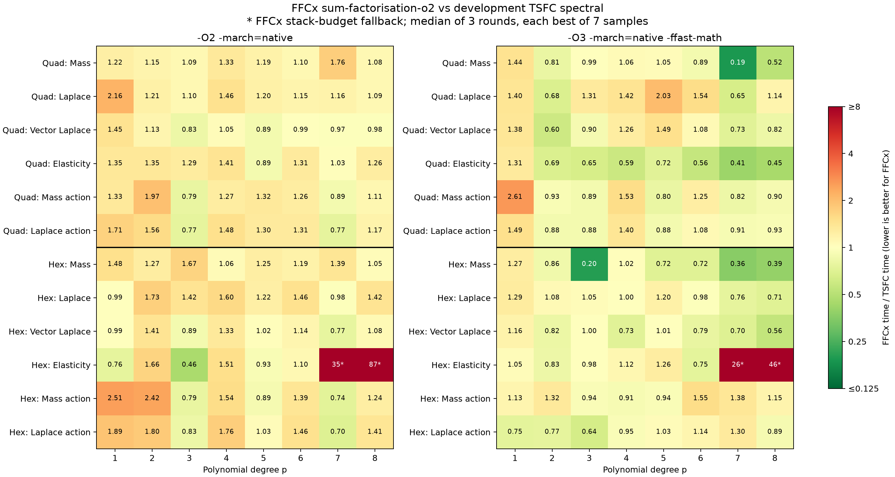

# FFCx vs development TSFC: quad and hex cell kernels

Date: 25 October 2026. These are standalone, hot element-kernel timings; they do not include Python, mesh traversal, assembly, or solver costs.

FFCx: `dokken/sum-factorisation-o2`, commit `fc0c2f298e479816429c2f1fea6bf8b7bdc02b50`. TSFC: Firedrake development HEAD `e8fab9d4f2ec6d5d25a467b99b68b3b98807ddb2`. FIAT/FInAT/GEM development HEAD `46e3eeecfd45f84e6bff2b4825309e43c8a102e5`. Both development revisions were checked against upstream HEAD before generation.

## Method

- Intel Xeon w7-3445; GCC 14.3.0; one process pinned to CPU 2.
- Scalar float64 GLL Lagrange Q_p bases; p=1-8; bilinear Q1 quads and trilinear Q1 hexes with non-affine geometry.
- Degree 2p Gauss-Legendre quadrature, giving p+1 points in every direction. This is identical for both compilers; no GLL collocation shortcut.
- FFCx uses `sum_factorization=True`. TSFC uses development `spectral` mode on native quad/hex cells. FInAT's converted hex basis has three independent index extents `(p+1, p+1, p+1)`, asserted for every degree. No extruded-cell replacement or release TSFC is used.
- Mass and Laplace bilinear forms, vector Laplace, elasticity `inner(sym(grad(u)), sym(grad(v))) + div(u)*div(v)`, and mass/Laplace coefficient actions.
- Actions use the same nonconstant scalar field, sampled at matching reference nodes, rather than a constant input.
- Same C driver, matching geometry and coefficient values, separate kernel/driver translation units, no LTO. Kernel calls accumulate into an already allocated tensor; allocation and zeroing are excluded from timing.
- Each executable calibrates to at least 10 ms per sample and takes 7 samples. Three complete sweeps shuffle compiler/case/flag ordering. Reported time is the median of the three per-sweep minima. Compilation and correctness validation finish before timing starts.
- CPU frequency is not fixed. Across the three sweeps, the median per-executable range (maximum round minimum / minimum round minimum - 1) is 3.2%; the 95th percentile is 13.1%. Near-parity differences should be treated accordingly.
- Standalone TSFC imports use no-op citation registration and an in-process memoisation shim for `pyop3.cache.serial_cache`. TSFC, FInAT and GEM code generation and optimization passes are unmodified; no Firedrake/PETSc runtime is timed.
- Process stack limit is 64 MiB for both compilers. Development TSFC's p8 hex elasticity kernel segfaults with the default 8 MiB stack; its O2 frame reserves about 10.15 MiB. FFCx retains its internal 256 KiB buffer guard and falls back to fused quadrature for hex elasticity at p7 and p8.

## Correctness

All 192 complete element tensor comparisons passed after mapping scalar basis and interleaved vector component orderings. Maximum absolute difference divided by the largest reference tensor entry: 7.92e-14. Maximum relative L2 difference: 7.16e-14.

## Aggregate comparison

Ratios are FFCx time / TSFC time: below 1 favors FFCx. Geometric means give equal weight to each of the 48 sampled form/degree cases per cell and flag set; they are not application speedups.

| Cell | Flags | FFCx faster | Geometric mean ratio | Directional cases only | Ratio range |
|---|---|---:|---:|---:|---:|
| quadrilateral | O2 | 10/48 | 1.191 | 1.191 | 0.766-2.156 |
| quadrilateral | O3fast | 28/48 | 0.933 | 0.933 | 0.192-2.613 |
| hexahedron | O2 | 13/48 | 1.418 | 1.209 | 0.457-87.218 |
| hexahedron | O3fast | 25/48 | 1.034 | 0.888 | 0.201-46.303 |



## Per-case times

Each entry is **FFCx / TSFC** in microseconds per kernel call. `*` marks FFCx's fused-quadrature fallback.

### quadrilateral, O2

| p | Mass | Laplace | Vector Laplace | Elasticity | Mass action | Laplace action |
|---:|---:|---:|---:|---:|---:|---:|
| 1 | 0.0191 / 0.0157 | 0.0643 / 0.0298 | 0.0551 / 0.0381 | 0.15 / 0.111 | 0.0105 / 0.0079 | 0.0235 / 0.0138 |
| 2 | 0.194 / 0.168 | 0.433 / 0.358 | 0.459 / 0.405 | 1.52 / 1.12 | 0.0778 / 0.0394 | 0.116 / 0.0742 |
| 3 | 0.311 / 0.284 | 0.447 / 0.407 | 0.481 / 0.583 | 1.71 / 1.33 | 0.0561 / 0.0708 | 0.103 / 0.135 |
| 4 | 2.16 / 1.63 | 4.28 / 2.92 | 3.57 / 3.41 | 13.8 / 9.8 | 0.337 / 0.266 | 0.505 / 0.34 |
| 5 | 2.44 / 2.04 | 4.28 / 3.58 | 4.36 / 4.9 | 16.4 / 18.5 | 0.29 / 0.22 | 0.485 / 0.373 |
| 6 | 7.9 / 7.2 | 15.8 / 13.7 | 15.4 / 15.5 | 57.1 / 43.7 | 0.614 / 0.487 | 1.07 / 0.816 |
| 7 | 7.93 / 4.5 | 11.7 / 10.1 | 12.3 / 12.6 | 45.8 / 44.5 | 0.376 / 0.424 | 0.679 / 0.886 |
| 8 | 24.9 / 22.9 | 46.7 / 43 | 47.1 / 48 | 176 / 139 | 1.12 / 1.01 | 1.93 / 1.65 |

### quadrilateral, O3fast

| p | Mass | Laplace | Vector Laplace | Elasticity | Mass action | Laplace action |
|---:|---:|---:|---:|---:|---:|---:|
| 1 | 0.015 / 0.0104 | 0.0392 / 0.028 | 0.044 / 0.0319 | 0.0823 / 0.0628 | 0.0141 / 0.00541 | 0.024 / 0.0161 |
| 2 | 0.0423 / 0.0523 | 0.112 / 0.165 | 0.146 / 0.243 | 0.529 / 0.771 | 0.0171 / 0.0183 | 0.0359 / 0.0406 |
| 3 | 0.0979 / 0.0992 | 0.272 / 0.207 | 0.577 / 0.639 | 1.79 / 2.75 | 0.0197 / 0.0222 | 0.0356 / 0.0402 |
| 4 | 0.521 / 0.49 | 1.36 / 0.959 | 1.47 / 1.16 | 5.37 / 9.11 | 0.0682 / 0.0444 | 0.142 / 0.102 |
| 5 | 0.718 / 0.685 | 3.29 / 1.62 | 3.65 / 2.46 | 13.2 / 18.2 | 0.0769 / 0.0957 | 0.161 / 0.183 |
| 6 | 1.72 / 1.94 | 6.76 / 4.38 | 7.01 / 6.5 | 27.8 / 49.8 | 0.18 / 0.145 | 0.361 / 0.335 |
| 7 | 2.1 / 10.9 | 4.47 / 6.85 | 7.46 / 10.2 | 35.9 / 87.3 | 0.118 / 0.143 | 0.264 / 0.291 |
| 8 | 4.21 / 8.07 | 17.5 / 15.3 | 17.1 / 20.8 | 68.7 / 153 | 0.236 / 0.262 | 0.584 / 0.626 |

### hexahedron, O2

| p | Mass | Laplace | Vector Laplace | Elasticity | Mass action | Laplace action |
|---:|---:|---:|---:|---:|---:|---:|
| 1 | 0.139 / 0.0937 | 0.275 / 0.279 | 0.291 / 0.292 | 1.65 / 2.17 | 0.109 / 0.0435 | 0.152 / 0.0804 |
| 2 | 1.96 / 1.54 | 7.44 / 4.3 | 7.46 / 5.29 | 62.1 / 37.3 | 0.514 / 0.213 | 0.921 / 0.511 |
| 3 | 5.14 / 3.08 | 11.2 / 7.87 | 11.7 / 13.2 | 104 / 228 | 0.482 / 0.611 | 1.06 / 1.28 |
| 4 | 45.2 / 42.7 | 144 / 90.1 | 155 / 116 | 1.35e+03 / 897 | 2.94 / 1.91 | 6.07 / 3.45 |
| 5 | 89.5 / 71.4 | 223 / 183 | 298 / 292 | 2.3e+03 / 2.47e+03 | 2.27 / 2.54 | 5.83 / 5.63 |
| 6 | 406 / 342 | 1.09e+03 / 748 | 1.19e+03 / 1.05e+03 | 1.03e+04 / 9.41e+03 | 7.43 / 5.36 | 17.3 / 11.8 |
| 7 | 522 / 376 | 979 / 997 | 1.27e+03 / 1.65e+03 | 9.28e+05 / 2.66e+04* | 4.94 / 6.65 | 11.4 / 16.3 |
| 8 | 2.07e+03 / 1.98e+03 | 5.5e+03 / 3.87e+03 | 6.61e+03 / 6.13e+03 | 4.81e+06 / 5.52e+04* | 17.1 / 13.8 | 42.7 / 30.4 |

### hexahedron, O3fast

| p | Mass | Laplace | Vector Laplace | Elasticity | Mass action | Laplace action |
|---:|---:|---:|---:|---:|---:|---:|
| 1 | 0.0469 / 0.0369 | 0.195 / 0.151 | 0.22 / 0.189 | 2.17 / 2.08 | 0.0293 / 0.0259 | 0.0464 / 0.0622 |
| 2 | 0.429 / 0.499 | 1.73 / 1.6 | 2.18 / 2.67 | 24.1 / 28.9 | 0.124 / 0.0939 | 0.261 / 0.34 |
| 3 | 1.52 / 7.58 | 6.96 / 6.64 | 11.8 / 11.8 | 209 / 212 | 0.159 / 0.169 | 0.43 / 0.676 |
| 4 | 13.2 / 12.9 | 41.8 / 41.6 | 45.6 / 62.1 | 724 / 648 | 0.602 / 0.661 | 1.39 / 1.46 |
| 5 | 30.1 / 42 | 135 / 112 | 223 / 221 | 2.45e+03 / 1.94e+03 | 0.796 / 0.845 | 2.3 / 2.23 |
| 6 | 86.2 / 120 | 360 / 368 | 548 / 690 | 5.67e+03 / 7.53e+03 | 2.6 / 1.68 | 5.75 / 5.06 |
| 7 | 155 / 426 | 752 / 990 | 1.11e+03 / 1.58e+03 | 6.27e+05 / 2.44e+04* | 2.68 / 1.94 | 8.05 / 6.17 |
| 8 | 491 / 1.25e+03 | 1.61e+03 / 2.27e+03 | 2.61e+03 / 4.71e+03 | 2.35e+06 / 5.07e+04* | 4.86 / 4.24 | 11.8 / 13.2 |

## Reproduction and artifacts

`environment.json` records revisions, package versions, hardware, compiler flags, interpreter paths, cache shims and work directory. `generate.py` generates each compiler's kernels; `run.py` compiles, checks and benchmarks them; `driver.c` is the shared timing driver; `report.py` regenerates this report and figures. `generated-kernels.tar.gz` contains the exact generated sources and nodal metadata. `samples.json` preserves every timing sample and calibrated iteration count. `results.csv`, `validation.json`, and `factorisation-audit.json` preserve the summaries, numerical errors and source hashes.

```bash
# Re-time the exact captured kernels without regenerating them.
WORK=/tmp/ffcx-tsfc-reproduce
mkdir -p "$WORK"
tar -xzf generated-kernels.tar.gz -C "$WORK"
OPENBLAS_NUM_THREADS=1 OMP_NUM_THREADS=1 "$FFCX_PYTHON" run.py "$WORK" --cpu 2 --rounds 3

# Use the interpreter paths and TSFC_PYTHONPATH recorded in environment.json.
WORK=/tmp/ffcx-tsfc-dev-benchmark-20261025/full
"$FFCX_PYTHON" generate.py ffcx "$WORK/ffcx"
XDG_CACHE_HOME=/tmp/tsfc-benchmark-cache PYTHONPATH="$TSFC_PYTHONPATH" "$TSFC_PYTHON" generate.py tsfc "$WORK/tsfc"
OPENBLAS_NUM_THREADS=1 OMP_NUM_THREADS=1 "$FFCX_PYTHON" run.py "$WORK" --cpu 2 --rounds 3
MPLCONFIGDIR=/tmp/tsfc-benchmark-matplotlib "$PLOT_PYTHON" report.py
```
