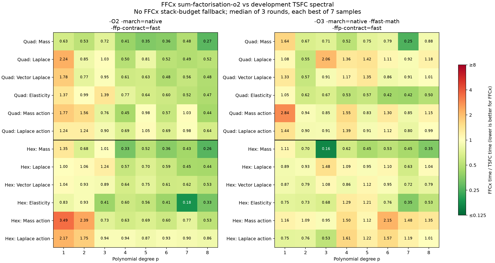

# FFCx vs development TSFC: quad and hex cell kernels

Date: 25 October 2026. Updated FFCx contractions with explicit FMA. These are standalone, hot element-kernel timings; they do not include Python, mesh traversal, assembly, or solver costs.

FFCx: `dokken/sum-factorisation-o2`, commit `b58a5c99f9b47559159a17f52eabb725ec8a53b1`. The recorded `changes.patch` contains the compiler changes from the benchmark base. TSFC: Firedrake development HEAD `e8fab9d4f2ec6d5d25a467b99b68b3b98807ddb2`. FIAT/FInAT/GEM development HEAD `46e3eeecfd45f84e6bff2b4825309e43c8a102e5`. Both development revisions were checked against upstream HEAD before generation.

## Method

- Intel Xeon w7-3445; GCC 14.3.0; one process pinned to CPU 2.
- Scalar float64 GLL Lagrange Q_p bases; p=1-8; bilinear Q1 quads and trilinear Q1 hexes with non-affine geometry.
- Degree 2p Gauss-Legendre quadrature, giving p+1 points in every direction. This is identical for both compilers; no GLL collocation shortcut.
- FFCx uses `sum_factorization=True`. TSFC uses development `spectral` mode on native quad/hex cells. FInAT's converted hex basis has three independent index extents `(p+1, p+1, p+1)`, asserted for every degree. No extruded-cell replacement or release TSFC is used.
- Mass and Laplace bilinear forms, vector Laplace, elasticity `inner(sym(grad(u)), sym(grad(v))) + div(u)*div(v)`, and mass/Laplace coefficient actions.
- Actions use the same nonconstant scalar field, sampled at matching reference nodes, rather than a constant input.
- Same C driver, matching geometry and coefficient values, separate kernel/driver translation units, no LTO. Kernel calls accumulate into an already allocated tensor; allocation and zeroing are excluded from timing.
- Each executable calibrates to at least 10 ms per sample and takes 7 samples. Three complete sweeps shuffle compiler/case/flag ordering. Reported time is the median of the three per-sweep minima. Compilation and correctness validation finish before timing starts.
- CPU frequency is not fixed. Across the three sweeps, the median per-executable range (maximum round minimum / minimum round minimum - 1) is 3.0%; the 95th percentile is 11.1%. Near-parity differences should be treated accordingly.
- Standalone TSFC imports use no-op citation registration and an in-process memoisation shim for `pyop3.cache.serial_cache`. TSFC, FInAT and GEM code generation and optimization passes are unmodified; no Firedrake/PETSc runtime is timed.
- Process stack limit is 64 MiB for both compilers. Development TSFC's p8 hex elasticity kernel needs more than the default 8 MiB stack. FFCx's stack-budget fallback has been removed; every benchmarked FFCx kernel uses directional contractions.
- Both compiler configurations explicitly use `-ffp-contract=fast`. A standalone assembly probe confirms that this GCC uses separate multiply/add instructions under the original C11 flags and an FMA with the explicit flag. O2 results do not use `-ffast-math`.
- FFCx precomputes weighted products of the one-dimensional basis tables. Its final contraction accumulates a complete contiguous row, expanding the independent row updates so GCC can apply SLP vectorization without reassociating the quadrature sums. No vector width or target-specific intrinsics are hardcoded.
- Intermediate argument contractions also accumulate along the contiguous last quadrature axis, with fixed-size independent updates. Coefficient evaluation uses the same point-row expansion. Each entry retains its original quadrature/dof accumulation order.

## Correctness

All 192 complete element tensor comparisons passed after mapping scalar basis and interleaved vector component orderings. Maximum absolute difference divided by the largest reference tensor entry: 7.91e-14. Maximum relative L2 difference: 7.16e-14.

## Aggregate comparison

Ratios are FFCx time / TSFC time: below 1 favors FFCx. Geometric means give equal weight to each of the 48 sampled form/degree cases per cell and flag set; they are not application speedups.

| Cell | Flags | FFCx faster | Geometric mean ratio | Directional cases only | Ratio range |
|---|---|---:|---:|---:|---:|
| quadrilateral | O2fma | 37/48 | 0.721 | 0.721 | 0.270-2.237 |
| quadrilateral | O3fast | 29/48 | 0.904 | 0.904 | 0.252-2.844 |
| hexahedron | O2fma | 39/48 | 0.716 | 0.716 | 0.182-3.488 |
| hexahedron | O3fast | 27/48 | 0.863 | 0.863 | 0.164-2.155 |



## Per-case times

Each entry is **FFCx / TSFC** in microseconds per kernel call. All cases use directional contractions.

### quadrilateral, O2fma

| p | Mass | Laplace | Vector Laplace | Elasticity | Mass action | Laplace action |
|---:|---:|---:|---:|---:|---:|---:|
| 1 | 0.0101 / 0.016 | 0.0548 / 0.0245 | 0.0646 / 0.0362 | 0.135 / 0.0989 | 0.0122 / 0.00686 | 0.0133 / 0.0108 |
| 2 | 0.116 / 0.219 | 0.274 / 0.323 | 0.293 / 0.382 | 1 / 1.01 | 0.061 / 0.0392 | 0.0786 / 0.0633 |
| 3 | 0.16 / 0.22 | 0.364 / 0.353 | 0.511 / 0.536 | 1.72 / 1.23 | 0.059 / 0.0772 | 0.103 / 0.115 |
| 4 | 0.719 / 1.77 | 1.61 / 3.21 | 1.75 / 2.86 | 6.59 / 8.58 | 0.121 / 0.27 | 0.202 / 0.294 |
| 5 | 1.02 / 2.93 | 2.5 / 3.08 | 2.79 / 4.42 | 10.5 / 16.5 | 0.206 / 0.21 | 0.353 / 0.337 |
| 6 | 2.37 / 6.59 | 5.84 / 11.3 | 6.36 / 13.3 | 23.8 / 39.6 | 0.255 / 0.446 | 0.489 / 0.703 |
| 7 | 1.95 / 4.04 | 4.85 / 10 | 6.51 / 11.6 | 21.7 / 41.3 | 0.424 / 0.413 | 0.731 / 0.743 |
| 8 | 5.79 / 21.5 | 19 / 36.8 | 19.7 / 41.3 | 61.7 / 132 | 0.427 / 0.976 | 0.898 / 1.41 |

### quadrilateral, O3fast

| p | Mass | Laplace | Vector Laplace | Elasticity | Mass action | Laplace action |
|---:|---:|---:|---:|---:|---:|---:|
| 1 | 0.0175 / 0.0107 | 0.0307 / 0.0284 | 0.0437 / 0.0328 | 0.0699 / 0.0666 | 0.0155 / 0.00545 | 0.0237 / 0.0164 |
| 2 | 0.0358 / 0.0535 | 0.0948 / 0.172 | 0.136 / 0.24 | 0.488 / 0.785 | 0.0174 / 0.0185 | 0.0367 / 0.0409 |
| 3 | 0.0718 / 0.101 | 0.425 / 0.206 | 0.574 / 0.63 | 1.81 / 2.71 | 0.019 / 0.0224 | 0.036 / 0.0395 |
| 4 | 0.248 / 0.476 | 1.29 / 0.954 | 1.41 / 1.2 | 4.82 / 9.14 | 0.0712 / 0.0458 | 0.142 / 0.103 |
| 5 | 0.535 / 0.718 | 2.25 / 1.58 | 3.34 / 2.47 | 11.2 / 19.6 | 0.0776 / 0.0934 | 0.164 / 0.179 |
| 6 | 1.49 / 1.9 | 4.9 / 4.42 | 5.76 / 6.68 | 21.3 / 50.2 | 0.186 / 0.143 | 0.382 / 0.342 |
| 7 | 2.8 / 11.1 | 6.66 / 7.21 | 9.19 / 10.1 | 37.1 / 88.1 | 0.121 / 0.142 | 0.241 / 0.301 |
| 8 | 7.18 / 8.18 | 18.7 / 15.9 | 21.6 / 21.3 | 80.8 / 160 | 0.307 / 0.266 | 0.611 / 0.614 |

### hexahedron, O2fma

| p | Mass | Laplace | Vector Laplace | Elasticity | Mass action | Laplace action |
|---:|---:|---:|---:|---:|---:|---:|
| 1 | 0.119 / 0.0877 | 0.257 / 0.257 | 0.289 / 0.278 | 1.77 / 2.12 | 0.116 / 0.0332 | 0.148 / 0.0682 |
| 2 | 1.12 / 1.65 | 4.11 / 3.88 | 4.42 / 4.76 | 33.9 / 36.5 | 0.446 / 0.187 | 0.752 / 0.429 |
| 3 | 3.16 / 3.12 | 9.07 / 7.31 | 11.3 / 12.6 | 86.7 / 212 | 0.454 / 0.625 | 0.957 / 1.01 |
| 4 | 20.2 / 61.9 | 54.3 / 95.1 | 62.5 / 97.4 | 499 / 838 | 1.26 / 2 | 2.88 / 3.07 |
| 5 | 37.3 / 71.7 | 117 / 168 | 211 / 282 | 1.31e+03 / 2.36e+03 | 1.69 / 2.46 | 4.35 / 5 |
| 6 | 114 / 317 | 395 / 671 | 596 / 980 | 3.81e+03 / 9.29e+03 | 3.09 / 5.17 | 8.9 / 9.57 |
| 7 | 157 / 363 | 443 / 994 | 1.04e+03 / 1.69e+03 | 4.72e+03 / 2.59e+04 | 5.08 / 6.6 | 11.8 / 13.1 |
| 8 | 504 / 1.91e+03 | 1.69e+03 / 3.82e+03 | 3.11e+03 / 5.9e+03 | 1.78e+04 / 5.49e+04 | 7.23 / 13.7 | 20.8 / 24.2 |

### hexahedron, O3fast

| p | Mass | Laplace | Vector Laplace | Elasticity | Mass action | Laplace action |
|---:|---:|---:|---:|---:|---:|---:|
| 1 | 0.0435 / 0.0391 | 0.135 / 0.152 | 0.161 / 0.184 | 1.53 / 2.05 | 0.0302 / 0.0261 | 0.0475 / 0.0634 |
| 2 | 0.347 / 0.498 | 1.5 / 1.62 | 2.06 / 2.6 | 21.5 / 29.3 | 0.106 / 0.0968 | 0.266 / 0.349 |
| 3 | 1.26 / 7.67 | 9.99 / 6.76 | 12.3 / 11.4 | 140 / 207 | 0.159 / 0.168 | 0.36 / 0.677 |
| 4 | 7.78 / 12.5 | 44.9 / 41.2 | 53 / 61.9 | 803 / 620 | 0.99 / 0.659 | 2.33 / 1.44 |
| 5 | 19.5 / 42.9 | 107 / 113 | 244 / 219 | 2.46e+03 / 2.02e+03 | 0.964 / 0.863 | 2.88 / 2.36 |
| 6 | 64 / 122 | 406 / 368 | 648 / 682 | 5.68e+03 / 7.52e+03 | 3.59 / 1.67 | 7.96 / 5.06 |
| 7 | 196 / 437 | 606 / 961 | 1.21e+03 / 1.68e+03 | 8.51e+03 / 2.42e+04 | 2.95 / 1.99 | 7.42 / 6.25 |
| 8 | 436 / 1.26e+03 | 2.31e+03 / 2.22e+03 | 3.8e+03 / 4.81e+03 | 2.71e+04 / 5.08e+04 | 5.91 / 4.37 | 13.3 / 13.2 |

## Reproduction and artifacts

`environment.json` records revisions, package versions, hardware, compiler flags, interpreter paths, cache shims and work directory. `generate.py` generates each compiler's kernels; `run.py` compiles, checks and benchmarks them; `driver.c` is the shared timing driver; `report.py` regenerates this report and figures. `generated-kernels.tar.gz` contains the exact generated sources and nodal metadata. `samples.json` preserves every timing sample and calibrated iteration count. `results.csv`, `validation.json`, and `factorisation-audit.json` preserve the summaries, numerical errors and source hashes.

```bash
# Re-time the exact captured kernels without regenerating them.
WORK=/tmp/ffcx-tsfc-reproduce
mkdir -p "$WORK"
tar -xzf generated-kernels.tar.gz -C "$WORK"
OPENBLAS_NUM_THREADS=1 OMP_NUM_THREADS=1 "$FFCX_PYTHON" run.py "$WORK" --cpu 2 --rounds 3

# Use the interpreter paths and TSFC_PYTHONPATH recorded in environment.json.
WORK=/tmp/ffcx-tsfc-dev-benchmark-20261025/full
"$FFCX_PYTHON" generate.py ffcx "$WORK/ffcx"
XDG_CACHE_HOME=/tmp/tsfc-benchmark-cache PYTHONPATH="$TSFC_PYTHONPATH" "$TSFC_PYTHON" generate.py tsfc "$WORK/tsfc"
OPENBLAS_NUM_THREADS=1 OMP_NUM_THREADS=1 "$FFCX_PYTHON" run.py "$WORK" --cpu 2 --rounds 3
MPLCONFIGDIR=/tmp/tsfc-benchmark-matplotlib "$PLOT_PYTHON" report.py
```
